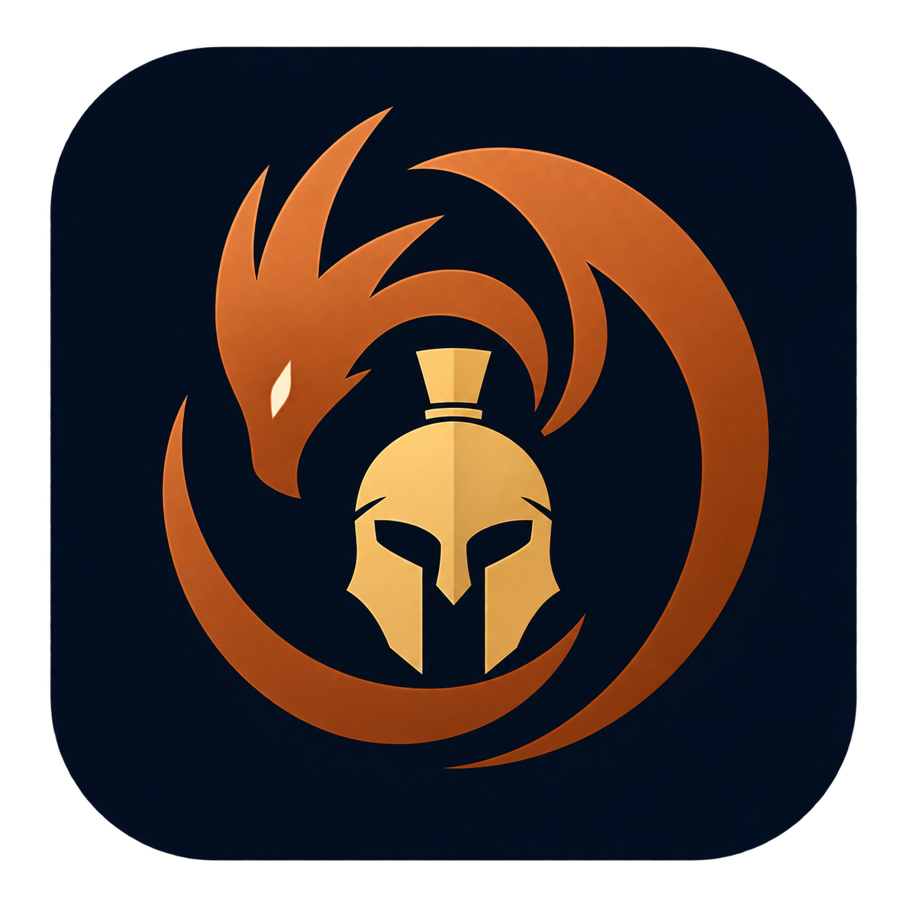

# Talos's Hoard

In **Audio → Session**, **Buscar en esta sesión** opens search for that exact
session ID, including when titles repeat. Text, kind and date filters combine
with that scope; searching all sessions removes only the scope and keeps the
fields. Errors support retry and changed criteria retire stale results. Links
retain original timestamps, including00:00. Counts describe returned native
hits, not an exhaustive total. `GET /audio/api/search` and `scribe_search` accept
optional `session_id`; omitted/empty searches all, an unknown ID returns no hits.
The same native index/tokenizer and97 tools remain. This reads stored text without
recording, transcription or model loading. No filter persistence across reloads
or page changes is promised. The interface keeps its existing Spanish language.

Activity → Today → **Where was I?** can read distinct recorded contexts before an
optional local date/time, request up to20 and include the categories omitted by
default. Blank date retains now/end-of-selected-day behavior. Read/Retry applies
the fields explicitly; Back to this day restores the original three-context query.
Results label the actual returned cut-off with time zone, requested maximum and
category scope. A future cut-off is reduced to now by the existing native query.
Known projects rank before bare apps within the three-day lookup; this is not a
global chronological list. Show in timeline keeps its explicit navigation.
Pending fields survive errors and copilot refresh of the applied query; edits
discard obsolete responses and changing day resets the filter. Titles do not prove
edits, and recorded paths are not opened or checked. Existing HTTP and
`activity_where_was_i` MCP97 contracts/engine are unchanged.

Clipboard History filters by **Aplicación registrada**, the exact, case-sensitive
saved process name. Combine it with text/type; **Todas las aplicaciones** clears
only the application. The result states its scope: up to 200 recent clips or 100
search matches ranked by relevance, not a global count. The recorded source is
the latest origin retained by native deduplication, not every past application.
Filter changes discard obsolete results; retry retains filters, open reader,
selection and bundle draft. The module keeps its existing Spanish interface.
Existing HTTP list/search and `clip_search` already accept `app`; `clip_recent`
now also accepts optional `app`, sharing the native filter (97 tools unchanged).
Reading/filtering starts no capture or model and does not write saved clips.

Clipboard → History now offers **Ver imagen** to inspect the complete saved PNG
without copying it to the OS clipboard. Fit and 100% modes retain the full image,
with local scrolling at original size, dimensions/source/ID and explicit retry.
Filters, selection and the text reader remain available. It uses the existing
image and metadata routes; MCP `clip_get` still returns dimensions and OCR text,
not image pixels or new OCR output.



Screen memory, clipboard history, desktop activity, audio, service monitoring and disk management in one local process. Incorporates Argus, Echo, Funes, Cassandra and DiskHoard.

[Castellano](README.es.md) · [Complete tool inventory](provenance/CAPABILITIES.md) · [Source provenance](provenance/sources.json)

## Independent modules

Every module is **OFF on first start**. Opening the app or discovering its MCP tools starts no collector, watcher, model or scanner. An explicit switch enables a module; disabling it stops its workers before closing its database. Your choices persist. Clipboard can run while screen capture, activity and audio remain off.

| Module | Preserved functions |
|---|---|
| Screen | Screenshots, OCR, visual and full-text search, similar frames, timeline, application activity, exclusions, private mode, import and folder watching, pinned frames, exports and retention |
| Clipboard | Text and image history, type detection, OCR, search, favourites, edit/delete/restore, copy and bundles |
| Activity | Foreground windows, idle/lock handling, recent files, Git commits, projects, classifications, privacy rules, summaries, exports and cross-module recall |
| Audio | Microphone/system recording, file import, streaming transcripts, search, notes, tags, exports, minutes, shared speech-to-text and GPU/CPU fallback |
| Services | Health checks, incidents, probable causes, logs, GPU history, event bus, job incidents, site/DNS/certificate/domain checks, notifications and restart policies |
| Disk | Space scan/tree, hotspots, largest and stale files, extension statistics, cleanup, recycle/permanent deletion safeguards, scripts, folder picker, ZIP splitting and model-backup management |

The full native interfaces remain under `/screen/`, `/clipboard/`, `/activity/`, `/audio/`, `/services/` and `/disk/`. The shared Hoard theme, product icon and Faustus copilot apply throughout. Capture backends and operating-system integrations retain their original platform requirements.

In **Activity → Projects**, **Resume** reads the selected project's recorded
foreground windows, file openings and commits through the existing
`activity_project_resume` calculation. The detail has its own look-back interval
(1–180 days) and maximum per evidence type (1–10), independent of the table's
period. Changing a detail parameter clears the old result; errors retain the
selection and parameters for Retry. The owner HTTP wrapper is
`POST /activity/api/projects/resume` with `project`, `days` and `limit`; the
existing MCP tool and combined 97-tool catalog are unchanged.

Names match the native exact project rules. Only windows lasting at least ten
seconds appear, while active time includes every active span in the interval.
Last foreground activity may be unknown even when recorded file openings exist.
An empty interval means no recorded evidence, not no work. Titles do not prove
edits or pending changes, and recorded file paths are not checked or opened.
Reading context starts no capture, model, file discovery or other application.

Clipboard History supports an ordered selection of up to 20 saved clips. **Reunir copias** reads their texts through the existing `clip_bundle` handler, shows source/date and partial-text notices, and lets you reorder, choose a separator, copy the combined text or download TXT. Selections remain visible when filtering and can be removed individually. Images contribute saved OCR text only; image files are not attached. Each clip uses the native 20,000-character limit, explicitly marked when partial. Previewing never changes stored clips. The module retains its Spanish interface. The owner's UI endpoint is `POST /clipboard/api/clips/bundle`; The existing bundle tool is unchanged.

**Leer texto** opens a non-image history clip in selectable, literal 4,000-character pages, including text beyond a bundle's prefix. Previous/Next use native Python character offsets, preserving emoji at page boundaries. Reading leaves the clipboard, search, selection and bundle drafts untouched; closing, switching clips or refreshing discards obsolete responses. `GET /clipboard/api/clips/{id}/text?offset=0&max_chars=4000` delegates to the existing `clip_get` handler, including its hidden/deleted access checks. MCP's existing response cap is separate from page size and remains unchanged. No new copy or capture action is added.

With exactly two selected clips, **Comparar dos copias** reads A/B explicitly through the same native bundle reader and shows literal line differences, origins/dates and counts. Spaces, tabs, LF/CRLF and missing final newline remain visible. Swap changes selection order; edits and copilot refresh discard obsolete results without deleting selection drafts. Copy includes the actual snapshot and scope. Images contribute only saved OCR text; no OCR, capture or real clipboard read is triggered. Uses Python's standard difflib; no model, semantic equivalence, minimum diff or applicable patch is promised.

`clip_compare {left_id,right_id,max_chars_per_clip}` and `POST /clipboard/api/clips/compare` share one calculation. The existing reader allows distinct IDs and up to20,000characters per text (tool default8,000; UI20,000). `left.truncated`, `right.truncated`, `text_scope=extracts` describe partial text: matching extracts do not establish equality of whole clips. UI/API receive every calculated row. Agent/MCP retains its existing best-effort ~20KB cap, which may independently cut rows and add a top-level `truncated` block; summary/total_rows still describe the full calculation. A very large nested row can still exceed that inherited budget. No global cap was changed or bypassed. Request a shorter prefix or use clip_get for the original text; do not describe a capped response as a complete diff. Clips and saved selections are not modified; copying the result is explicit.

## Run

Inside **Reunir copias**, **Selecciones guardadas** stores a named selection of
up to 20 clip IDs, their order, separator and origin/date option. Load explicitly
to replace the editable draft; review explicitly to read current clip contents.
Save changes (including rename), save as new or delete only the saved selection.
Original clips are never copied, moved, pinned or edited by these operations.
Missing IDs remain visible/removable; the existing bundle reader reports them.
Native tools `clip_selections`, `clip_selection_save` and `clip_selection_delete`
share SQLite metadata with `GET/POST /clipboard/api/clips/selections` and
`DELETE /clipboard/api/clips/selections/{id}`. IDs/options persist across reloads;
the stored selection contains no clip text or image. Capture/OCR and module
activation keep their existing explicit controls.

Python 3.11+; Windows is required for Windows desktop capture and system integrations. From this folder:

```powershell
python -m venv .venv
.venv\Scripts\python.exe -m pip install -r requirements.txt
.venv\Scripts\python.exe -m talos_hoard --no-browser
```

Open `http://127.0.0.1:5220`. `Start.cmd` performs the initial environment setup if needed. The server never opens a window automatically. Hoard Hub reads `faustus-plugin.json` for explicit launch and MCP access.

## Existing data

No history is copied, moved, cleared or converted during adoption. With all modules OFF, map the old data folders in place:

```powershell
.venv\Scripts\python.exe scripts\adopt_data.py --parent "C:\path\to\Hoards"
```

This writes only `data/modules.json`. Existing databases, screenshots, clipboard images, recordings, settings, tokens and disk snapshots stay in their original folders. Keep those folders. `data_paths` can also be edited while the server is stopped. A new installation without adoption uses `data/<module>`.

On activation, the native engine resumes its normal behaviour, including its saved privacy and retention settings. Disabling a module never deletes its history. In-progress operations finish before OFF is reported; live event streams are disconnected. Large media responses stream without loading whole recordings into memory.

`TALOS_DATA_DIR`, `TALOS_PORT` and `--port` override the central data folder and port. Original module environment variables still configure their capture/model backends. `TALOS_TOKEN_FILE` and `TALOS_URL` configure the MCP bridge.

## API and MCP

`GET /api/modules`, `PUT /api/modules/{id}` with `{"enabled":true|false}`, and `POST /api/modules/stop-all` control the modules. `GET /api/agent/tools` exposes 97 tools: the original 91 native tools, three saved-selection tools, `clip_compare` and `talos_modules` and `talos_set_module`. `POST /api/agent/call` requires the bearer token in `data/mcp-token`. Calls to an OFF module return `module_disabled`; they never enable it implicitly.

Run `.venv\Scripts\python.exe mcp_server.py` for stdio MCP. Its catalogue works without a running Talos server and never launches one. Native API names, record identifiers and source citations are preserved. Recall calls screen, clipboard and audio directly inside this process.

Retired Hoard identities may remain registered as **non-launchable compatibility entries** pointing at these module routes. They preserve family token authentication, references and cross-Hoard calls; they do not run old servers. Funes's family audio tools are also routed through `/legacy/funes/`.

## Development and verification

Install `pytest pytest-asyncio` in the same environment. Run `python -m pytest tests -q`. `legacy_tests/` retains the incorporated engines' regression tests; run each engine's suite separately where helper modules have identical names. `scripts/qa_server.py` starts a synthetic instance with fake capture/audio and offline network engines. `scripts/verify_mcp.py --data-dir <QA-data>` checks the real stdio transport against that instance.

UI sources live under `ui/`; each has its own lockfile. Run `npm ci` and `npm run build` inside the relevant UI directory. Built assets ship with the repository. `scripts/build_catalog.py` rebuilds the static native tool definitions without opening histories or starting engines.

Text-model requests use the family's configured global Sparks service. Audio and visual engines retain their native optional model downloads and local GPU leases; no model loads while its module is OFF. `provenance/` records licenses and exact source commits. Cinzel and Source Sans 3 ship under their included SIL Open Font Licenses.


## Owned data and compatibility

Native module data can be relocated into `data/native/<module>/data`, with per-module configuration beside it. Writer fiction uses the owning desktop profile `writers-hoard/fiction/data`. Move complete data trees, including SQLite WAL/SHM, media, downloaded models and browser sessions; update saved absolute paths before enabling a module. The compatibility manifests in `compatibility/<id>/faustus-plugin.json` preserve native IDs, tool schemas and tokens without a retired checkout. Add each merged application's `compatibility` directory to Hub roots before the general repository root. Discovery and compatibility bridges never start an application. All modules remain OFF during relocation.

Legacy in-place adoption scripts are optional import helpers; keeping the old repository is unnecessary once relocation and route updates have been verified.
